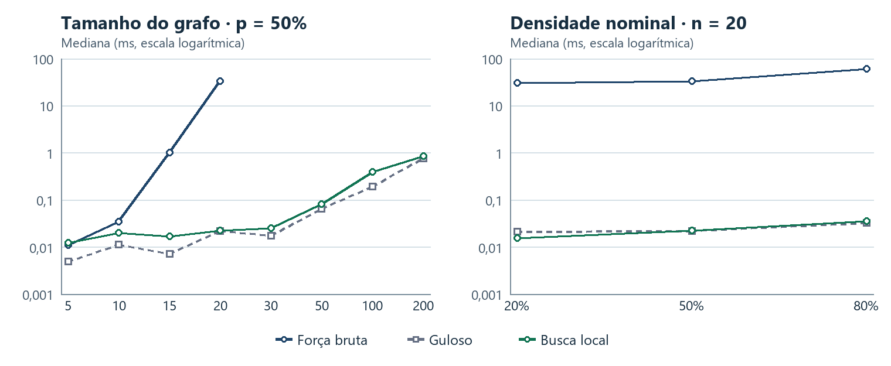

# Problema da Clique Máxima

## Relatório de implementação e análise experimental

- **Instituição** Universidade Comunitária da Região de Chapecó (UNOCHAPECÓ)
- **Área** AATEC · Área de Agrárias, Engenharias e Tecnologias
- **Curso** Ciência da Computação (Bacharelado)
- **Disciplina** Análise e Complexidade de Algoritmos
- **Professor** Gabriel Henrique Moro
- **Integrantes** Bruno Antunes, Edson Leandro Soares, Pedro Toigo e Vitor Rodi
- **Apresentação** Chapecó, 26 de novembro de 2026

<!-- quebra -->

## Sumário

1. Introdução · 1
2. Objetivos · 1
3. Metodologia e ambiente · 1
4. Representação e algoritmos · 2
5. Testes e validação · 3
6. Resultados experimentais · 3
   - 6.1 Efeitos do tamanho e da densidade · 4
7. Discussão e limitações · 5
8. Conclusão · 5

Referências · 6

<!-- quebra -->

## 1 Introdução

O Problema da Clique Máxima pede o maior conjunto de vértices mutuamente adjacentes de um grafo simples e não direcionado. O TPE demonstrou a NP-completude de CLIQUE, sua versão de decisão, e fundamentou duas heurísticas. Este relatório descreve a implementação e mede o que ocorre quando os três métodos são submetidos às mesmas instâncias.

## 2 Objetivos

Implementar a enumeração exata, o guloso construtivo e a busca local com troca e expansão. Verificar validade, maximalidade e tamanho por testes independentes. Medir o custo de execução das três estratégias e quantificar a qualidade quando houver uma referência exata.

## 3 Metodologia e ambiente

O experimento foi executado em 24 de novembro de 2026 com Node.js 22.22.2 em Windows x64, release 10.0.26300, Intel Core i7-10750H a 2,60 GHz e 12 processadores lógicos. A aplicação local usa React, TypeScript, Vite, Tailwind CSS, Cytoscape.js e Recharts. A automação usa Vitest, ESLint, Prettier e GitHub Actions.

Foram gerados grafos G(n,p) com n ∈ {5, 10, 15, 20, 30, 50, 100, 200}, p ∈ {0,20; 0,50; 0,80} e cinco sementes por configuração. A amostra tem 120 grafos aleatórios e uma instância de referência do TPE. Cada método elegível fez um aquecimento e cinco repetições por instância. A ordem foi alternada e o objeto de grafo foi compartilhado entre as abordagens.

O relógio de alta resolução registrou a geração separadamente. Mediram-se os algoritmos em Node.js com instrumentação e sem gravação de etapas. Os tempos do navegador foram gerados em Web Worker, com rastros e sem renderização dentro da janela cronometrada.

<!-- quebra -->

## 4 Representação e algoritmos

A matriz de adjacência simétrica usa n² bytes de células e tem diagonal nula. Cada consulta custa O(1). Vértices têm identificadores únicos e as arestas são pares não ordenados. Na importação, o modelo rejeita laços, duplicatas e referências inexistentes. A ordem de entrada resolve empates de forma determinística.

**Força bruta.** O percurso decide, para cada vértice, se o inclui ou exclui do subconjunto. Em cada folha, verifica os pares até encontrar uma incompatibilidade ou certificar a clique. Mantém a maior clique válida encontrada. Como cada subconjunto aparece uma vez, a enumeração completa certifica o ótimo. Em um grafo completo, cada par aparece em 2ⁿ⁻² subconjuntos e o pior caso é Θ(n² · 2ⁿ). A pilha e os subconjuntos de trabalho ocupam O(n).

**Guloso.** O método escolhe o primeiro vértice de grau máximo no conjunto de candidatos P. A interseção de P com seus vizinhos preserva a adjacência com todos os escolhidos. Quando P acaba, a clique é maximal. Recalcular os graus em P custa O(n²) por até n etapas, produzindo O(n³) de tempo e O(n) de espaço auxiliar. Em Kₙ, a cota cúbica é atingida.

**Busca local.** A clique gulosa inicia a busca. Para cada troca unitária válida entre um membro e um vértice externo, a expansão gulosa considera candidatos adjacentes a todos os membros resultantes. A primeira clique estritamente maior inicia nova rodada. A maior cardinalidade nunca diminui. Com O(n²) trocas por rodada, O(n³) de expansão por troca e O(n) rodadas, O(n⁶) é uma cota conservadora. O espaço auxiliar é O(n). A busca para sem melhora nessa vizinhança ou pelo limite configurado.

Os limites auxiliares excluem a matriz e o rastro, que pode ocupar O(n²) quando ativado. Os três métodos seguem as variantes didáticas do TPE. A estratégia gulosa foi inspirada na heurística primal discutida por Cavique, Rego e Themido (2002), e a busca local usa operações de vizinhança descritas nessa literatura.

<!-- quebra -->

## 5 Testes e validação

A suíte passou em 46 testes. Foram cobertas famílias de grafos, entradas inválidas, desempate, validade das soluções e ausência de certificado após interrupção. Um oráculo independente de Bron–Kerbosch verificou a força bruta nos 1.100 grafos rotulados de zero a cinco vértices e em instâncias aleatórias de semente conhecida. O oráculo é exclusivo dos testes.

Na versão compilada, foram verificados o destaque das cliques, a navegação por etapas, a edição e a importação de instâncias, o cancelamento, o limite de tempo e os filtros. Os testes no navegador bloquearam acessos externos e verificaram a adaptação a uma tela de 390 px.

## 6 Resultados experimentais

Das 1.815 tentativas planejadas, 1.515 foram concluídas com cliques válidas e 300 foram classificadas como não executadas. Essas 300 correspondem à força bruta acima de 20 vértices. Nenhuma execução do benchmark atingiu o limite de 5 s.

Tabela 1 – Resultado e mediana de cinco repetições em Node.js no grafo do TPE

| Algoritmo | Clique | Mediana (ms) | Qualidade | Desvio |
| --- | --- | ---: | ---: | ---: |
| Força bruta | A, B, C, D | 0,0214 | 100% | 0% |
| Guloso | X, A, B | 0,0024 | 75% | 25% |
| Busca local | A, B, C, D | 0,0043 | 100% | 0% |

Fonte dos dados – Execução do benchmark, 2026.

No TPE, X tem grau seis e é o primeiro vértice escolhido pelo guloso. Após a escolha de A e B não há inserção válida. A busca local troca X por C e então expande a clique com D. A enumeração dos 512 subconjuntos certifica ω(G) = 4.

<!-- quebra -->

## 6.1 Efeitos do tamanho e da densidade

Figura 1 – Tempos medianos conforme tamanho e densidade nominal

Fonte dos dados – Execução do benchmark, 2026.

Para n = 20 e p = 50%, as medianas de força bruta, guloso e busca local foram 33,1400 ms, 0,0220 ms e 0,0225 ms. Na força bruta, as medianas de 30,4668 ms em p = 20% e 60,3710 ms em p = 80% são compatíveis com verificações de pares mais longas quando há mais arestas.

Tabela 2 – Cardinalidades observadas nas duas heurísticas em n = 200

| Densidade nominal | Cardinalidade média | Melhor observada |
| ---: | ---: | ---: |
| 20% | 5,0 | 6 |
| 50% | 9,4 | 10 |
| 80% | 23,2 | 25 |

Fonte dos dados – Execução do benchmark, 2026.

A força bruta certificou os 60 grafos aleatórios de até 20 vértices. Cada heurística atingiu 57 ótimos nessa parte da amostra, com qualidade média de 98,83% e desvio médio de 1,17%. Para n = 200, as duas produziram as mesmas cardinalidades por instância e o ótimo ficou indeterminado.

<!-- quebra -->

## 7 Discussão e limitações

O tempo da enumeração cresce rapidamente mesmo com saída antecipada ao encontrar um par incompatível. A maior duração de força bruta observada com n = 20 foi 67,8042 ms. A medição sustenta o limite inicial nesta amostra, com margem em relação ao teto de 5 s. Grafos maiores ou com outra estrutura podem exigir mais tempo.

A busca local recuperou um vértice no exemplo TPE. Entre os 120 casos aleatórios, produziu cliques maiores em três grafos de 100 vértices. As melhorias foram de 4 para 5 em p = 20%, semente 71, de 9 para 10 em p = 50%, semente 53, e de 20 para 21 em p = 80%, semente 37. Nas outras 117 instâncias, as cardinalidades coincidiram. A qualidade percentual depende de ω(G). Sem certificado nos grafos grandes, as três diferenças indicam ganhos de cardinalidade observados.

O conjunto experimental contém cinco sementes por combinação e usa uma família geradora. As diferenças de tempo muito pequenas são sensíveis ao aquecimento e ao escalonamento. A busca local com troca unitária pode parar em um ótimo da vizinhança, mesmo quando existem melhorias que exigem múltiplas trocas. As cotas assintóticas decorrem da análise das operações.

## 8 Conclusão

O laboratório reproduziu as três cliques do TPE, tornou observável a troca que explica a melhoria e confirmou a enumeração exata com um oráculo independente. Os dados medidos mostram uma diferença de custo entre enumeração e heurísticas e registram ganhos de cardinalidade em instâncias específicas. A escolha da abordagem depende do tamanho do grafo e da necessidade de certificar o ótimo.

<!-- quebra -->

## Referências

CAVIQUE, Luís; REGO, César; THEMIDO, Isabel. Estruturas de vizinhança e procura local no problema da clique máxima. *Investigação Operacional*, v. 22, p. 1–18, 2002.
GIBBONS, Luana E. et al. Continuous characterizations of the maximum clique problem. *DIMACS Technical Report 96-09*, 1996.
KARP, Richard M. Reducibility among combinatorial problems. In: MILLER, R. E.; THATCHER, J. W. (ed.). *Complexity of computer computations*. New York: Plenum Press, 1972. p. 85–103. DOI: 10.1007/978-1-4684-2001-2_9.
UNIVERSITY OF MICHIGAN. Introduction to complexity. *EECS 376: Foundations of Computer Science*, [s.d.]. Acesso em 24 nov. 2026. [Notas da disciplina](https://eecs376.github.io/notes/complexity.html).
WU, Qinghua; HAO, Jin-Kao. A review on algorithms for maximum clique problems. *European Journal of Operational Research*, v. 242, n. 3, p. 693–709, 2015. DOI: 10.1016/j.ejor.2014.09.064.
