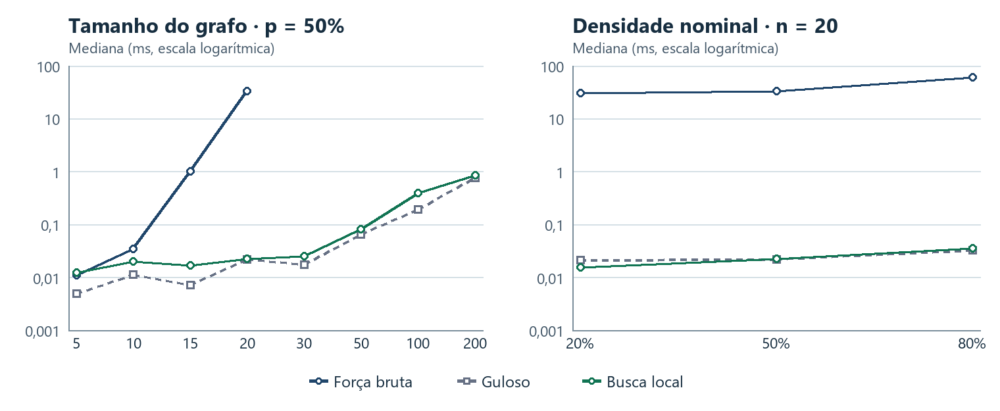

# Resultados experimentais

O benchmark foi executado em 24 nov. 2026, às 09h56 no horário de Brasília, em Windows x64 (release 10.0.26300), Intel Core i7-10750H a 2,60 GHz, 12 processadores lógicos, Node.js 22.22.2 e V8 12.4.254.21-node.39. Os metadados originais e registros estão em [benchmark.json](../results/benchmark.json).

## Execuções e instância principal

| Algoritmo   | Completas | Não executadas | Interrompidas |
| ----------- | --------: | -------------: | ------------: |
| Força bruta |       305 |            300 |             0 |
| Guloso      |       605 |              0 |             0 |
| Busca local |       605 |              0 |             0 |
| Total       |     1.515 |            300 |             0 |

Todas as 1.515 soluções retornadas foram verificadas como válidas. O TPE confirmou cardinalidades 4, 3 e 4. As medianas das cinco repetições em Node.js foram 0,0214 ms, 0,0024 ms e 0,0043 ms na mesma ordem. Os indicadores foram 100%, 75% e 100% de qualidade e 0%, 25% e 0% de desvio.

## Tempo e densidade

Medianas em milissegundos para n = 20, com 25 medições concluídas por célula.

| Densidade nominal | Força bruta | Guloso | Busca local |
| ----------------: | ----------: | -----: | ----------: |
|               20% |     30,4668 | 0,0210 |      0,0152 |
|               50% |     33,1400 | 0,0220 |      0,0225 |
|               80% |     60,3710 | 0,0325 |      0,0355 |

A maior medição de força bruta com 20 vértices foi 67,8042 ms, com todas as execuções terminadas dentro do limite. A maior densidade tende a atrasar a descoberta de pares sem aresta na enumeração e manter candidatos por mais tempo nas heurísticas. Na amostra, a mediana de força bruta aproximadamente dobrou de p = 20% para 80%, com n fixo. Diferenças pequenas entre as heurísticas oscilam com aquecimento, escalonamento e a resolução efetiva do relógio.

## Qualidade e cliques maiores

| Conjunto                                               | Guloso | Busca local |
| ------------------------------------------------------ | -----: | ----------: |
| Ótimos atingidos nos 60 grafos aleatórios certificados |     57 |          57 |
| Qualidade média nesses 60 grafos                       | 98,83% |      98,83% |
| Desvio médio nesses 60 grafos                          |  1,17% |       1,17% |
| Melhores cliques observadas em n = 200, p = 80%        |     25 |          25 |

A busca local melhorou 3 de 120 grafos aleatórios, com n = 100 em todos: 4 → 5 para p = 20%, semente 71, 9 → 10 para p = 50%, semente 53, e 20 → 21 para p = 80%, semente 37. As três melhorias foram verificadas como cliques. Como ω(G) não foi certificado nesses tamanhos, o ganho é uma diferença de cardinalidade observada.

Com 200 vértices, as duas heurísticas tiveram cardinalidade média de 5,0, 9,4 e 23,2 conforme p cresceu de 20% para 80%. Seus melhores valores foram 6, 10 e 25. A busca local igualou o guloso nos outros 117 casos aleatórios e o melhorou no exemplo TPE. Os resultados dependem do conjunto de instâncias e da vizinhança escolhida.

[CSV das configurações](../results/benchmark-summary.csv) · [Metodologia](experimental-methodology.md)
